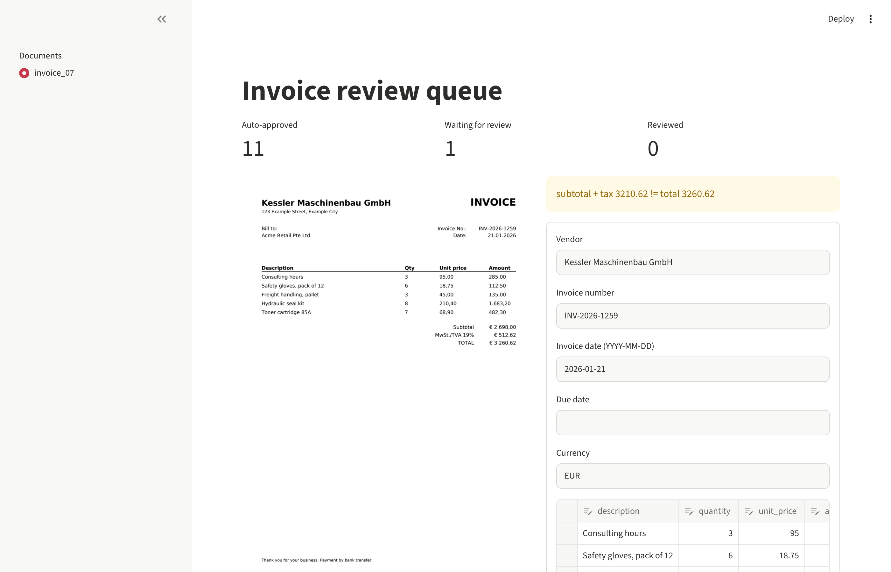
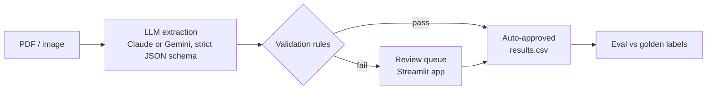

# AI Invoice Extractor

[](https://github.com/AI-WFox/ai-invoice-extractor/actions/workflows/tests.yml)


Turn invoices (PDFs and phone scans) into clean, structured data, with
arithmetic checks, a human review queue for anything doubtful, and an
evaluation harness that measures how often the automation is wrong.

Built for accounts-payable teams, bookkeepers and back offices that still
retype invoices into spreadsheets or ERPs by hand.



*The review queue. Eleven sample invoices passed every check; one, whose printed total does not add up, waits for a person.*

## Why this design

Most "AI extraction" demos stop at "the model returned JSON". In production
the hard part is knowing **when not to trust it**. This pipeline splits the
work:

| Step | Who does it | Why |
|---|---|---|
| Read the page | Claude or Gemini (vision + PDF input, JSON-schema structured output) | Handles any layout, language, number format, or scan quality without templates |
| Check the result | Plain Python rules | Line items × price = amount, items sum to subtotal, subtotal + tax = total, valid dates, ISO currency, model's own "unsure" flags |
| Decide | Rules | Pass → auto-approved. Fail → review queue |
| Fix the rest | A person, in the review app | Side-by-side document and editable fields, re-validated on approve |
| Measure | `eval` command against golden labels | Reports the **silent error rate**: wrong documents that passed every check |



## What's in the box

```
invoice_extractor/
  schema.py     Pydantic model shared by extraction, labels and review
  extract.py    Claude call: PDF/image in, validated Invoice out
  extract_gemini.py  same with Gemini (free tier), retries on rate limits
  validate.py   deterministic business rules -> needs_review or not
  evaluate.py   field accuracy, straight-through rate, silent error rate
  __main__.py   CLI: run / eval
review_app.py   Streamlit review queue
scripts/make_samples.py   synthetic invoices with exact ground truth
samples/        12 invoices (USD, EUR with 1.234,56 format, VND, scans, one misprinted total)
tests/          runs offline with a fake client, no API key needed
```

## Quickstart

```bash
pip install -r requirements.txt

# 1. extract every document in a folder, with either backend
export ANTHROPIC_API_KEY=...            # key from console.anthropic.com
python -m invoice_extractor run samples/docs --out out

export GEMINI_API_KEY=...               # free key from aistudio.google.com
python -m invoice_extractor run samples/docs --out out --backend gemini

# 2. score it against the golden labels
python -m invoice_extractor eval out samples/gold

# 3. review whatever was flagged
streamlit run review_app.py -- --results out --docs samples/docs
```

Offline tests:

```bash
pytest -q
```

Output of `run`: one JSON per document plus `out/results.csv`
(file, status, vendor, number, date, currency, total, issues), ready to
import into Excel, Google Sheets, QuickBooks or an ERP.

## Results on the sample set

Run step 2 above and paste the summary here. The eval prints:

- `fully_correct`: share of documents with every field right
- `field_accuracy`: per field
- `straight_through_rate`: share auto-approved with no human touch
- `silent_error_rate`: share auto-approved **and** wrong (the number to drive to zero)
- `errors_caught_by_validation`: wrong documents the rules sent to review

`invoice_07` deliberately has a printed total that doesn't add up; the
rules must route it to review.

## Adapting it to your documents

The same structure works for receipts, purchase orders, bills of lading,
bank statements, insurance claims, lab reports or contracts:

1. Change the fields in `schema.py`.
2. Add the checks your team already does by eye to `validate.py`.
3. Label 30 to 50 of your real documents as JSON in a `gold/` folder.
4. Run `eval`, look at the failures, adjust the prompt or rules, repeat.

Gemini's free tier is enough to try it (requests are sent one at a time
and retried when the rate limit or a busy model hits; set `GEMINI_MODEL` to pick another
model). Typical cost with Claude Opus 5.5 is a few cents per page; measure it on
your documents (`--effort low` is cheaper and often enough for clean PDFs).

## Notes

- Uses Anthropic's structured outputs, so the response always matches the schema.
- Server-side fallback is enabled: if a request is declined by a safety
  classifier, it is retried on a fallback model in the same call.
- Documents are sent to the chosen provider's API. On Gemini's free tier,
  Google may use inputs to improve its products, so use only sample or
  non-sensitive documents there.

## License

MIT
